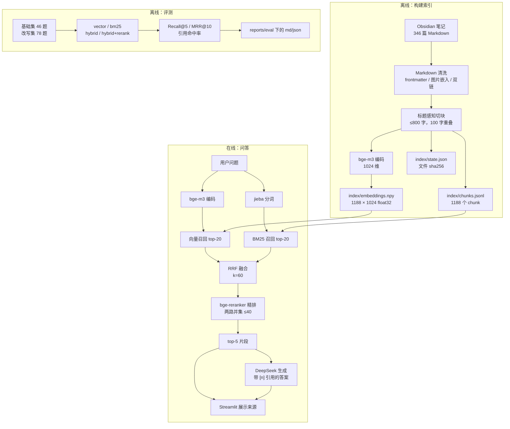

# Obsidian 课程笔记 RAG

基于本地 Obsidian「电子电路基础」课程笔记的检索增强问答 demo。

- 346 篇 Markdown，1188 个 chunk
- 标题感知切块，答案带 `[n]` 引用，可追溯到具体笔记和章节
- bge-m3 向量 + BM25 混合召回，RRF 融合，cross-encoder 精排
- 自建基础集与「不含标题原词」的改写集，量化对比 4 种检索配置
- 无向量数据库，无 LangChain，核心管线手写

## 项目亮点

- 在 78 条不含标题原词的改写题上，纯向量 Recall@5 为 **70.5%**，精排后达到 **87.2%**。
- 复现 HyDE：纯稠密检索的 Recall@5 从 **70.5%** 提升到 **84.6%**，MRR 提升约 0.09。
- 发现并修复 RRF 候选池截断问题：单路召回的正确结果会在精排前被丢弃。
- 索引支持按文件内容哈希增量更新，改一篇笔记只重嵌该篇的 chunk。
- 无 DeepSeek API key 时自动退化为仅检索模式，评测仍可完整运行。

## 全工作流



## 核心设计

### 1. 标题感知切块

课程笔记本身就是「一章一个文件夹、一节一个文件、内部有 `##` 小标题」的结构，直接利用：

- 按 ATX 标题切段，代码块里的 `#` 不参与识别
- chunk 正文前缀为 `笔记名 > H1 > H2`，embedding 时保留上下文
- 超长章节按段落打包，单块不超过 800 字符，相邻块重叠 100 字符
- 小于 50 字符的碎块并入上一块
- 去掉 YAML frontmatter，删除图片嵌入，把 `[[双链]]` 还原为纯文本

### 2. 混合检索与融合

- 向量召回：bge-m3 编码，与 `embeddings.npy` 做点积（向量已归一化，点积即余弦）
- 稀疏召回：jieba 分词 + `rank_bm25`
- 两路各取 top-20，用 RRF（k=60）融合
- 精排：bge-reranker-base 对两路召回的全部候选打分，取 top-5

**关键修正：RRF 只用于排序，不用于截断候选池。** 早期实现把 RRF 前 20 条送进精排，导致只被单路召回的正确结果被丢弃。案例 p03 中，金标笔记在 BM25 排第 17、RRF 融合后排第 30，精排看不到它；改为对两路并集（≤40）精排后，该题直接排到第 1。

### 3. 引用与公式

- prompt 强制答案标注 `[n]`，引用编号对应传入的片段
- 答案后附来源列表：笔记路径 + 标题路径
- 模型偶尔输出 `\( \)` / `\[ \]` 定界符，渲染前统一转换成 Streamlit 支持的 `$...$` / `$$...$$`

### 4. 增量索引

`state.json` 保存每个笔记的内容 SHA256，`chunk_id` 由「笔记路径 + 标题路径 + 序号」哈希得到：

- 内容没变的笔记：直接复用旧 chunk 和旧向量
- 内容变化：只重新切块、重新 embedding 该笔记
- 已删除的笔记：其 chunk 自然不再进入索引
- 解析失败的文件：不写入状态，下次运行自动重试

### 5. 为什么不用向量数据库

1188 个 1024 维向量只占约 4.9MB，一次全量点积是亚毫秒级。这个规模下：

- numpy 暴力检索是**精确**的，ANN 反而有召回损失
- 不需要维护 `FAISS index ↔ chunk_id` 映射
- 少一个依赖，Windows 上少一类安装问题

瓶颈在 CPU 精排（约 7–11 秒/题），不在向量检索。规模到十万级再考虑 FAISS / hnswlib。

## 评测结果

评测只衡量检索质量，不调用生成模型（引用命中率除外）。

### 基础集（46 题）

题目由作者根据笔记编写，关键词与标题重合度较高，适合做回归基线。

| 配置 | Recall@5 | MRR@10 | 耗时 |
|---|---|---|---|
| vector | 0.978 | 0.905 | 8.0 s |
| bm25 | 0.957 | 0.846 | 0.2 s |
| hybrid | 0.978 | 0.918 | 7.9 s |
| hybrid+rerank | 1.000 | 0.889 | 456.1 s |

### 改写集（78 题，关键结果）

提问时刻意不使用笔记标题里的原词，例如：

> MOS 管的源极没有和芯片衬底接到同一个电位时，开启它所需的栅压为什么会变高？漏极电流会怎样？
> gold：`18-MOSFET物理基础及电路模型/1.13-体效应与大信号模型.md`

| 配置 | Recall@5 | MRR@10 |
|---|---|---|
| vector | 0.705 | 0.569 |
| bm25 | 0.667 | 0.518 |
| hybrid | 0.679 | 0.580 |
| hybrid+rerank | 0.872 | 0.683 |

早期 12 条 pilot 上，精排曾把 Recall@5 从 0.917 提升到 1.000；扩充到 78 题后结果更接近真实分布。历史对比见 `docs/improvements.md`。

### HyDE 复现实验（78 题，纯稠密检索）

| 模式 | Recall@5 | MRR@10 | ΔMRR vs query | 胜/负/平 |
|---|---|---|---|---|
| query | 0.705 | 0.569 | - | - |
| hyde | 0.846 | 0.646 | +0.077 | 22/11/45 |
| query+hyde | 0.795 | 0.649 | +0.080 | 17/8/53 |
| multi-hyde | 0.808 | 0.661 | +0.092 | 24/11/43 |

- HyDE 明显改善改写题召回，但在 46 题基础集上 MRR 从 0.905 降到 0.866，关键词重合度高时并不划算。
- 本实验只测纯稠密检索，用于隔离 HyDE 变量。

### HyDE + 混合检索 + 精排（78 题）

| 模式 | Recall@5 | MRR@10 |
|---|---|---|
| hybrid+rerank | 0.872 | 0.683 |
| hyde-aug-hybrid+rerank | 0.872 | 0.692 |
| hyde-aug-hybrid（不精排） | 0.769 | 0.636 |

结论：加入精排后，HyDE 基本是中性的——78 题中 1 胜 1 负 76 平，ΔMRR +0.009，95% CI 跨 0。精排已经弥补了第一阶段的召回缺口，HyDE 的额外生成成本和更大的精排候选池在当前配置下不划算。

但在不精排时，HyDE 把混合检索从 0.679 / 0.580 提到 0.769 / 0.636，说明它确实改善了第一阶段候选。若限制精排预算（例如只精排 top-20），HyDE 的价值可能重新出现，这是下一步待验证的问题。

复现命令：

```powershell
# 纯稠密 HyDE 对比
uv run python -m hyde.dense --questions eval/questions.paraphrase.jsonl --samples 3 --out reports/hyde/dense_paraphrase.json

# HyDE + 混合检索 + 精排
uv run python -m hyde.rerank --questions eval/questions.paraphrase.jsonl --out reports/hyde/rerank_paraphrase.json
```

### 指标定义

- **Recall@5**：top-5 结果按笔记去重后，包含金标笔记的题目占比
- **MRR@10**：top-10 按笔记去重后，金标笔记首次出现排名的倒数，取平均
- **引用命中率**：答案中被引用的片段至少有一个来自金标笔记的题目占比

### 样本量说明

- 46 题时，1 题约等于 2.2 个百分点
- 78 题时，1 题约等于 1.3 个百分点

小样本上的差距只写趋势，不写精确的百分比提升。

## 快速开始（可选）

面试官通常只需要看评测结果和设计；需要复现时按下面步骤。

### 环境

- Python 3.11+（在 Windows 11 + Python 3.14 验证）
- [uv](https://docs.astral.sh/uv/)
- 首次运行会下载 bge-m3 与 bge-reranker-base，约 3.3GB

### 1. 安装依赖

```bash
git clone https://github.com/peagothedreamer/obsidian-rag.git
cd obsidian-rag
uv sync
```

### 2. 准备笔记

仓库不包含课程笔记（`notes/` 已被 gitignore）。把「电子电路基础」的正文 Markdown 放到：

```
notes/电子电路基础/
```

保留章节目录结构，并排除：

- `lec1`–`lec11`：前 11 章的重复副本
- `_源课件`、`_素材`：源文件和附件目录

排除后共 346 篇正文。

### 3. 配置 API key（可选）

```bash
cp .env.example .env
```

PowerShell 用 `Copy-Item .env.example .env`。编辑 `.env`：

```text
DEEPSEEK_API_KEY=sk-你的key
```

不配置也能运行：问答会自动进入「仅检索模式」，评测不受影响。

### 4. 构建索引

```bash
uv run python -m rag.index
```

首次运行会下载模型，CPU 建索引约 3–5 分钟。再次运行只处理变更文件。

模型缓存默认在项目内的 `.cache/huggingface`。国内网络可以在 `.env` 中设置镜像：

```text
HF_ENDPOINT=https://hf-mirror.com
```

也可以用 `HF_HOME` 指定其他缓存目录。

### 5. 跑评测

```bash
# 基础集 46 题
uv run python -m rag.eval

# 改写集 78 题，单独输出报告
uv run python -m rag.eval --questions eval/questions.paraphrase.jsonl --out reports/eval/paraphrase.md

# 额外统计引用命中率（需要 API key）
uv run python -m rag.eval --questions eval/questions.paraphrase.jsonl --out reports/eval/paraphrase_generation.md --generation
```

### 6. 启动界面

```bash
uv run streamlit run app.py --server.address 127.0.0.1
```

打开 http://127.0.0.1:8501 。首次提问需要加载模型，约 10–20 秒；之后每次提问约 7–11 秒，主要耗在 CPU 精排。

## 常用命令

| 命令 | 作用 |
|---|---|
| `uv run python -m rag.index` | 增量建索引 |
| `uv run python -m rag.index --rebuild` | 忽略缓存全量重建 |
| `uv run python -m rag.search "问题"` | 只检索，打印 top-5 片段和分数 |
| `uv run python -m rag.ask "问题"` | 检索 + 生成答案 |
| `uv run python -m rag.eval` | 跑 4 种配置的检索评测 |
| `uv run python -m rag.eval --questions eval/xxx.jsonl --out reports/xxx.md` | 评测指定题集 |
| `uv run python -m rag.eval --generation` | 额外统计引用命中率 |
| `uv run python -m rag.eval --draft 20` | 从索引生成 20 条草稿题 |
| `uv run pytest -q` | 运行测试 |
| `uv run streamlit run app.py --server.address 127.0.0.1` | 启动问答界面 |

## 项目结构

```
obsidian-rag/
├── app.py                  # Streamlit 单页问答
├── rag/
│   ├── config.py           # 路径、模型名、切块参数、.env 加载
│   ├── chunker.py          # 标题感知切块
│   ├── index.py            # 增量索引与向量持久化
│   ├── search.py           # 向量 + BM25 + RRF + 精排
│   ├── ask.py              # DeepSeek 生成、引用解析、公式格式转换
│   └── eval.py             # 4 种配置消融、指标与报告
├── eval/
│   ├── questions.jsonl             # 基础集 46 题
│   ├── questions.paraphrase.jsonl  # 改写集 78 题
│   └── questions.draft.jsonl       # 草稿题，gitignore
├── hyde/
│   ├── common.py           # 缓存、生成、编码共用逻辑
│   ├── dense.py            # 纯稠密 HyDE 实验
│   ├── rerank.py           # HyDE + 混合检索 + 精排
│   ├── cache/              # 生成缓存，gitignore
│   └── results/            # 实验报告 json / md
├── notes/                  # 课程笔记副本，gitignore
├── index/                  # chunks / embeddings / state，gitignore
├── reports/
│   ├── eval/
│   │   ├── base.md/json        # 46 题基础集
│   │   ├── paraphrase.md/json  # 78 题改写集
│   │   └── archive/            # 旧版 12 题与修复前报告
│   └── hyde/
│       ├── dense_base.md/json
│       ├── dense_paraphrase.md/json
│       └── rerank_paraphrase.md/json
├── tests/test_pipeline.py  # 切块、增量索引、RRF、指标、公式转换
└── docs/
    ├── specs/              # 设计文档
    ├── plans/              # 实现计划
    └── improvements.md     # 实验记录与改进清单
```

## 已知局限

- 只覆盖「电子电路基础」一门课，领域窄，不能说明通用检索能力
- 基础集题目与标题关键词重合度高，分数偏乐观；78 条改写题仍由作者编写，存在选题偏差
- 图片、PDF 附件未解析；公式只作为文本参与检索
- CPU 精排约 7–11 秒/题，交互体验一般
- 评测题由作者编写，存在选题偏差
- 笔记数据不随仓库分发，复现需要自备同结构笔记

## 后续计划

- 继续扩充改写集（目标 100+），加入跨章节和计算题
- 在限制精排候选预算（如 top-20）下评估 HyDE 的收益
- 对比 `bge-large-zh-v1.5`、`gte-multilingual-base` 等 embedding 模型
- A/B 测试 bge 查询指令前缀
- 去掉 chunk 前缀里「笔记名 + H1」重复的部分
- 尝试 ONNX / 量化精排，降低交互延迟
- 点击引用直接跳转到 Obsidian 对应笔记

## 测试

```powershell
uv run pytest -q
```

覆盖：

- 标题切块与代码围栏识别
- 长章节切分与重叠
- 增量索引只重嵌变更笔记
- RRF 融合排序
- Recall@5 / MRR@10 计算
- LaTeX 定界符转换

## 数据说明

课程笔记属于个人学习资料，未包含在仓库中。`reports/` 只包含评测指标和检索结果路径，不包含笔记全文。

## 参考

- HyDE: [Precise Zero-Shot Dense Retrieval without Relevance Labels](https://aclanthology.org/2023.acl-long.99/)（[arXiv](https://arxiv.org/abs/2212.10496)、[代码](https://github.com/texttron/hyde)）
- [BAAI/bge-m3](https://huggingface.co/BAAI/bge-m3)
- [BAAI/bge-reranker-base](https://huggingface.co/BAAI/bge-reranker-base)
- [DeepSeek API](https://platform.deepseek.com/)
- [Streamlit](https://streamlit.io/)
