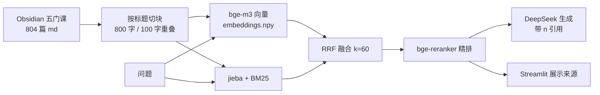

# 本地 Obsidian 笔记 RAG Demo 实现计划

> **For agentic workers:** REQUIRED SUB-SKILL: Use superpowers:subagent-driven-development (recommended) or superpowers:executing-plans to implement this plan task-by-task. Steps use checkbox (`- [ ]`) syntax for tracking.

**Goal:** 在五门课（804 篇 Markdown）上构建一个带引用问答、可量化消融评测的本地 RAG demo。

**Architecture:** 手写最小管线。按 Obsidian 标题切块，bge-m3 做稠密向量、jieba + BM25 做稀疏召回，RRF 融合后 bge-reranker 精排，DeepSeek 生成带 `[n]` 引用的答案。检索质量用自建评测集比较 4 种配置。

**Tech Stack:** Python 3.13、uv、sentence-transformers、rank-bm25、jieba、numpy、openai（DeepSeek 兼容接口）、streamlit、pytest。

**Spec:** `F:\projects\obsidian-rag\docs\superpowers\specs\2026-11-17-obsidian-rag-design.md`

## Global Constraints

- 项目根目录：`F:\projects\obsidian-rag`。
- 笔记库：`F:\Desktop\Obsidian Vault`；只索引 `复变函数与积分变换`、`概率论与数理统计`、`大学物理Ⅱ`、`电子电路基础`、`软件技术基础` 五个目录。
- 模型：embedding `BAAI/bge-m3`，reranker `BAAI/bge-reranker-base`，生成 `deepseek-chat`。
- 切块：最大 800 字符，重叠 100 字符，小于 50 字符的碎块并入上一块。
- 检索：向量与 BM25 各取 top-20，RRF `k=60`，精排后返回 top-5；评测时取 top-10。
- 存储：`index/chunks.jsonl` + `index/embeddings.npy` + `index/state.json`，不引入向量数据库。
- 所有命令从项目根目录执行，统一用 `uv run`。
- 不改动 Obsidian vault 内任何文件（只读）。
- 测试不加载真实模型、不调用网络。
- 本机实测 `huggingface.co` 连接超时、`hf-mirror.com` 可用：`rag/config.py` 顶部用 `os.environ.setdefault` 设置 `HF_ENDPOINT=https://hf-mirror.com` 和 `HF_HOME=F:\hf-cache`；所有模块先 import `rag.config`，再 import `sentence_transformers`。
- 本机未设置 `DEEPSEEK_API_KEY`；无 key 时只验证仅检索模式，生成链路待配置 key 后手测。

---

### Task 1: 项目骨架、配置与切块

**Files:**
- Create: `pyproject.toml`
- Create: `.gitignore`
- Create: `rag/__init__.py`
- Create: `rag/config.py`
- Create: `rag/chunker.py`
- Test: `tests/test_pipeline.py`

**Interfaces:**
- Consumes: 无。
- Produces:
  - `rag.config` 常量：`VAULT: Path`、`COURSE_DIRS: list[str]`、`INDEX_DIR: Path`、`EMBEDDING_MODEL`、`RERANK_MODEL`、`DEEPSEEK_API_KEY`、`DEEPSEEK_MODEL`、`DEEPSEEK_BASE_URL`、`CHUNK_MAX_CHARS=800`、`CHUNK_OVERLAP_CHARS=100`、`CHUNK_MIN_CHARS=50`、`RECALL_K=20`、`RRF_K=60`、`TOP_K=5`。
  - `rag.chunker.Chunk` dataclass：字段 `chunk_id, note_path, note_title, heading_path, text, char_count, ordinal`。
  - `rag.chunker.chunk_note(note_path: str, note_title: str, text: str, max_chars=None, overlap=None, min_chars=None) -> list[Chunk]`。
  - `rag.chunker.pack_paragraphs(body: str, max_chars: int, overlap: int) -> list[str]`。

- [ ] **Step 1: 初始化仓库与项目文件**

```bash
cd /f/projects/obsidian-rag
git init
```

创建 `pyproject.toml`：

```toml
[project]
name = "obsidian-rag"
version = "0.1.0"
description = "Local Obsidian notes RAG with measurable retrieval quality"
requires-python = ">=3.11"
dependencies = [
    "sentence-transformers>=3.0",
    "rank-bm25>=0.2.2",
    "jieba>=0.42.1",
    "numpy>=2.0",
    "openai>=1.40",
    "streamlit>=1.40",
]

[dependency-groups]
dev = ["pytest>=8.0"]

[tool.pytest.ini_options]
pythonpath = ["."]
testpaths = ["tests"]
```

创建 `.gitignore`：

```
.venv/
index/
__pycache__/
*.pyc
.pytest_cache/
```

创建 `rag/__init__.py`（空文件）。

- [ ] **Step 2: 写失败测试**

创建 `tests/test_pipeline.py`：

```python
import numpy as np

from rag.chunker import chunk_note, pack_paragraphs


def test_chunk_heading_paths_ignore_code_fence():
    text = (
        "# 第一章\n\n"
        + "引言内容，" * 20 + "\n\n"
        "```python\n# 这不是标题\nprint(1)\n```\n\n"
        "## 1.1 小节\n\n"
        + "小节正文内容，" * 20 + "\n"
    )
    chunks = chunk_note("课程/笔记.md", "笔记", text)
    paths = {c.heading_path for c in chunks}
    assert "第一章" in paths
    assert "第一章 > 1.1 小节" in paths
    assert all("这不是标题" not in p for p in paths)
    assert all(c.text.startswith("笔记 > 第一章") for c in chunks)


def test_pack_paragraphs_overlaps_and_caps_length():
    parts = pack_paragraphs("字" * 2000, max_chars=800, overlap=100)
    assert len(parts) >= 3
    assert all(len(p) <= 800 for p in parts)
    assert parts[0][-100:] == parts[1][:100]
```

- [ ] **Step 3: 运行测试确认失败**

Run: `uv run pytest tests/test_pipeline.py -v`
Expected: 首次运行会安装依赖（torch 等约 2–3GB，需要等待几分钟），然后 FAIL，`ModuleNotFoundError: No module named 'rag.config'` 或 `rag.chunker`。

- [ ] **Step 4: 实现配置**

创建 `rag/config.py`：

```python
"""项目配置。所有可调参数集中在这里。"""
import os
from pathlib import Path

# 本机实测 huggingface.co 不可达，走镜像；模型缓存放 F 盘。
os.environ.setdefault("HF_ENDPOINT", "https://hf-mirror.com")
os.environ.setdefault("HF_HOME", r"F:\hf-cache")

PROJECT_ROOT = Path(__file__).resolve().parent.parent

VAULT = Path(os.environ.get("OBSIDIAN_VAULT", r"F:\Desktop\Obsidian Vault"))

COURSE_DIRS = [
    d.strip()
    for d in os.environ.get(
        "COURSE_DIRS",
        "复变函数与积分变换,概率论与数理统计,大学物理Ⅱ,电子电路基础,软件技术基础",
    ).split(",")
    if d.strip()
]

INDEX_DIR = Path(os.environ.get("INDEX_DIR", PROJECT_ROOT / "index"))

EMBEDDING_MODEL = os.environ.get("EMBEDDING_MODEL", "BAAI/bge-m3")
RERANK_MODEL = os.environ.get("RERANK_MODEL", "BAAI/bge-reranker-base")

DEEPSEEK_API_KEY = os.environ.get("DEEPSEEK_API_KEY")
DEEPSEEK_MODEL = os.environ.get("DEEPSEEK_MODEL", "deepseek-chat")
DEEPSEEK_BASE_URL = os.environ.get("DEEPSEEK_BASE_URL", "https://api.deepseek.com")

CHUNK_MAX_CHARS = 800
CHUNK_OVERLAP_CHARS = 100
CHUNK_MIN_CHARS = 50

RECALL_K = 20
RRF_K = 60
TOP_K = 5
```

- [ ] **Step 5: 实现切块**

创建 `rag/chunker.py`：

```python
"""Markdown → chunks，按 Obsidian 标题层级切分。"""
import hashlib
import re
from dataclasses import dataclass

from . import config

HEADING = re.compile(r"^(#{1,6})\s+(.+?)\s*$")
IMAGE_EMBED = re.compile(r"!\[\[[^\]]*\]\]")
WIKILINK = re.compile(r"\[\[([^\]|]+)(?:\|([^\]]+))?\]\]")


@dataclass
class Chunk:
    chunk_id: str
    note_path: str
    note_title: str
    heading_path: str
    text: str
    char_count: int
    ordinal: int


def strip_frontmatter(text: str) -> str:
    """去掉文件开头的 YAML frontmatter。"""
    if text.startswith("---"):
        end = text.find("\n---", 3)
        if end != -1:
            text = text[end + 4:]
    return text.lstrip("\n")


def clean_obsidian(text: str) -> str:
    """删掉图片嵌入，把 wikilink 还原成纯文本。"""
    text = IMAGE_EMBED.sub("", text)
    return WIKILINK.sub(lambda m: (m.group(2) or m.group(1)).strip(), text)


def split_sections(text: str) -> list[tuple[str, str]]:
    """按 ATX 标题切段，返回 (标题路径, 正文)。代码块内的 # 不算标题。"""
    sections: list[tuple[str, str]] = []
    stack: list[tuple[int, str]] = []
    buf: list[str] = []
    in_fence = False

    def flush() -> None:
        body = "\n".join(buf).strip()
        if body:
            sections.append((" > ".join(t for _, t in stack), body))
        buf.clear()

    for line in text.splitlines():
        stripped = line.strip()
        if stripped.startswith("```") or stripped.startswith("~~~"):
            in_fence = not in_fence
            buf.append(line)
            continue
        match = None if in_fence else HEADING.match(stripped)
        if match:
            flush()
            level = len(match.group(1))
            while stack and stack[-1][0] >= level:
                stack.pop()
            stack.append((level, match.group(2).strip()))
        else:
            buf.append(line)
    flush()
    return sections


def pack_paragraphs(body: str, max_chars: int, overlap: int) -> list[str]:
    """按段落打包，超长时切分，相邻块保留 overlap 字符重叠。"""
    paragraphs = [p.strip() for p in body.split("\n\n") if p.strip()]
    chunks: list[str] = []
    cur = ""
    for para in paragraphs:
        while para:
            room = max_chars - len(cur) - (2 if cur else 0)
            if room <= 0:
                chunks.append(cur)
                cur = cur[-overlap:] if overlap else ""
                continue
            piece, para = para[:room], para[room:]
            cur = f"{cur}\n\n{piece}" if cur else piece
            if para:
                chunks.append(cur)
                cur = cur[-overlap:] if overlap else ""
    if cur.strip():
        chunks.append(cur)
    return chunks


def _prefix(note_title: str, heading_path: str) -> str:
    """chunk 前缀：笔记名 + 标题路径，去重。"""
    parts = [note_title]
    parts += [h for h in heading_path.split(" > ") if h and h != note_title]
    return " > ".join(dict.fromkeys(parts))


def chunk_note(
    note_path: str,
    note_title: str,
    text: str,
    max_chars: int | None = None,
    overlap: int | None = None,
    min_chars: int | None = None,
) -> list[Chunk]:
    max_chars = max_chars or config.CHUNK_MAX_CHARS
    overlap = overlap if overlap is not None else config.CHUNK_OVERLAP_CHARS
    min_chars = min_chars or config.CHUNK_MIN_CHARS

    text = clean_obsidian(strip_frontmatter(text))
    chunks: list[Chunk] = []
    for heading_path, body in split_sections(text):
        if len(body) < min_chars and chunks:
            prev = chunks[-1]
            prev.text = f"{prev.text}\n\n{body}"
            prev.char_count = len(prev.text)
            continue
        prefix = _prefix(note_title, heading_path)
        for piece in pack_paragraphs(body, max_chars, overlap):
            full = f"{prefix}\n{piece}"
            ordinal = len(chunks)
            cid = hashlib.sha1(
                f"{note_path}#{heading_path}#{ordinal}".encode("utf-8")
            ).hexdigest()[:16]
            chunks.append(
                Chunk(cid, note_path, note_title, heading_path, full, len(full), ordinal)
            )
    return chunks
```

- [ ] **Step 6: 运行测试确认通过**

Run: `uv run pytest tests/test_pipeline.py -v`
Expected: 2 passed。

- [ ] **Step 7: 提交**

```bash
git add pyproject.toml .gitignore rag/ tests/
git commit -m "feat: project skeleton and heading-based chunker"
```

---

### Task 2: 索引与增量更新

**Files:**
- Create: `rag/index.py`
- Modify: `tests/test_pipeline.py`（追加测试）

**Interfaces:**
- Consumes: `rag.config`、`rag.chunker.Chunk`、`rag.chunker.chunk_note`。
- Produces:
  - `build_index(index_dir: Path | None = None, vault_dir: Path | None = None, course_dirs: list[str] | None = None, rebuild: bool = False, embed_fn=None) -> dict`，返回 `{"notes": int, "chunks": int, "reused_chunks": int, "embedded_chunks": int}`。
  - `load_chunks(index_dir: Path) -> list[Chunk]`。
  - `iter_note_files(vault_dir: Path, course_dirs: list[str]) -> list[Path]`。
  - CLI：`python -m rag.index [--rebuild]`。

- [ ] **Step 1: 写失败测试**

在 `tests/test_pipeline.py` 末尾追加：

```python
from rag import index as index_mod


def test_incremental_index_reuses_unchanged(tmp_path):
    vault = tmp_path / "vault"
    (vault / "课程").mkdir(parents=True)
    note_a = vault / "课程" / "a.md"
    note_b = vault / "课程" / "b.md"
    note_a.write_text("# A\n\n" + "甲" * 300, encoding="utf-8")
    note_b.write_text("# B\n\n" + "乙" * 300, encoding="utf-8")

    calls: list[int] = []

    def fake_embed(texts):
        calls.append(len(texts))
        return np.ones((len(texts), 4), dtype=np.float32)

    index_dir = tmp_path / "index"

    stats1 = index_mod.build_index(
        index_dir=index_dir, vault_dir=vault, course_dirs=["课程"], embed_fn=fake_embed
    )
    assert stats1["chunks"] == 2
    assert stats1["embedded_chunks"] == 2

    stats2 = index_mod.build_index(
        index_dir=index_dir, vault_dir=vault, course_dirs=["课程"], embed_fn=fake_embed
    )
    assert stats2["embedded_chunks"] == 0
    assert stats2["reused_chunks"] == 2

    note_a.write_text("# A\n\n" + "甲" * 400, encoding="utf-8")
    stats3 = index_mod.build_index(
        index_dir=index_dir, vault_dir=vault, course_dirs=["课程"], embed_fn=fake_embed
    )
    assert stats3["embedded_chunks"] == 1
    assert stats3["reused_chunks"] == 1
    assert calls[-1] == 1
```

- [ ] **Step 2: 运行测试确认失败**

Run: `uv run pytest tests/test_pipeline.py::test_incremental_index_reuses_unchanged -v`
Expected: FAIL，`ModuleNotFoundError: No module named 'rag.index'`。

- [ ] **Step 3: 实现索引**

创建 `rag/index.py`：

```python
"""构建和增量更新 chunk + embedding 索引。"""
import argparse
import hashlib
import json
import sys
from dataclasses import asdict
from pathlib import Path

import numpy as np

from . import config  # 必须先于 sentence_transformers 导入（设置 HF 镜像）
from .chunker import Chunk, chunk_note
from sentence_transformers import SentenceTransformer

_model = None


def _get_model() -> SentenceTransformer:
    global _model
    if _model is None:
        _model = SentenceTransformer(config.EMBEDDING_MODEL)
    return _model


def _default_embed(texts: list[str]) -> np.ndarray:
    return _get_model().encode(
        texts, batch_size=32, normalize_embeddings=True, show_progress_bar=False
    )


def _sha256(path: Path) -> str:
    return hashlib.sha256(path.read_bytes()).hexdigest()


def iter_note_files(vault_dir: Path, course_dirs: list[str]) -> list[Path]:
    files: list[Path] = []
    for course in course_dirs:
        root = vault_dir / course
        if not root.is_dir():
            raise FileNotFoundError(f"课程目录不存在: {root}")
        files.extend(sorted(root.rglob("*.md")))
    return files


def load_chunks(index_dir: Path) -> list[Chunk]:
    path = index_dir / "chunks.jsonl"
    if not path.exists():
        return []
    lines = path.read_text(encoding="utf-8").splitlines()
    return [Chunk(**json.loads(line)) for line in lines if line.strip()]


def build_index(
    index_dir: Path | None = None,
    vault_dir: Path | None = None,
    course_dirs: list[str] | None = None,
    rebuild: bool = False,
    embed_fn=None,
) -> dict:
    index_dir = Path(index_dir or config.INDEX_DIR)
    vault_dir = Path(vault_dir or config.VAULT)
    course_dirs = course_dirs or config.COURSE_DIRS
    embed_fn = embed_fn or _default_embed
    index_dir.mkdir(parents=True, exist_ok=True)

    files = iter_note_files(vault_dir, course_dirs)
    current_hash = {f.relative_to(vault_dir).as_posix(): _sha256(f) for f in files}

    old_state: dict[str, str] = {}
    state_path = index_dir / "state.json"
    if not rebuild and state_path.exists():
        old_state = json.loads(state_path.read_text(encoding="utf-8"))

    old_chunks = [] if rebuild else load_chunks(index_dir)
    emb_path = index_dir / "embeddings.npy"
    old_vec_by_id: dict[str, np.ndarray] = {}
    if old_chunks and emb_path.exists():
        old_vectors = np.load(emb_path)
        if len(old_vectors) == len(old_chunks):
            for chunk, vec in zip(old_chunks, old_vectors):
                old_vec_by_id[chunk.chunk_id] = vec

    old_chunks_by_note: dict[str, list[Chunk]] = {}
    for chunk in old_chunks:
        old_chunks_by_note.setdefault(chunk.note_path, []).append(chunk)

    all_chunks: list[Chunk] = []
    new_chunks: list[Chunk] = []
    skipped: list[tuple[str, str]] = []
    reused = 0
    for path in files:
        rel = path.relative_to(vault_dir).as_posix()
        old_note_chunks = old_chunks_by_note.get(rel, [])
        unchanged = old_state.get(rel) == current_hash[rel] and all(
            c.chunk_id in old_vec_by_id for c in old_note_chunks
        )
        if unchanged:
            all_chunks.extend(old_note_chunks)
            reused += len(old_note_chunks)
        else:
            try:
                note_chunks = chunk_note(
                    rel, path.stem, path.read_text(encoding="utf-8")
                )
            except Exception as exc:
                skipped.append((rel, str(exc)))
                continue
            all_chunks.extend(note_chunks)
            new_chunks.extend(note_chunks)

    # 解析失败的文件不写入 state，下次运行会重试。
    for rel, _ in skipped:
        current_hash.pop(rel, None)
    if skipped:
        print(f"跳过 {len(skipped)} 个文件:", file=sys.stderr)
        for rel, message in skipped:
            print(f"  {rel}: {message}", file=sys.stderr)

    new_vec_by_id: dict[str, np.ndarray] = {}
    if new_chunks:
        new_vectors = np.asarray(embed_fn([c.text for c in new_chunks]), dtype=np.float32)
        if len(new_vectors) != len(new_chunks):
            raise ValueError("embed_fn 返回的向量数与 chunk 数不一致")
        for chunk, vec in zip(new_chunks, new_vectors):
            new_vec_by_id[chunk.chunk_id] = vec

    if all_chunks:
        vectors = np.stack(
            [
                new_vec_by_id[c.chunk_id] if c.chunk_id in new_vec_by_id else old_vec_by_id[c.chunk_id]
                for c in all_chunks
            ]
        )
    else:
        vectors = np.zeros((0, 0), dtype=np.float32)

    with (index_dir / "chunks.jsonl").open("w", encoding="utf-8") as fh:
        for chunk in all_chunks:
            fh.write(json.dumps(asdict(chunk), ensure_ascii=False) + "\n")
    np.save(emb_path, vectors)
    state_path.write_text(
        json.dumps(current_hash, ensure_ascii=False, indent=2), encoding="utf-8"
    )

    return {
        "notes": len(files),
        "chunks": len(all_chunks),
        "reused_chunks": reused,
        "embedded_chunks": len(new_chunks),
    }


def main() -> None:
    parser = argparse.ArgumentParser(description="构建 Obsidian 笔记索引")
    parser.add_argument("--rebuild", action="store_true", help="忽略缓存全量重建")
    args = parser.parse_args()
    stats = build_index(rebuild=args.rebuild)
    print(json.dumps(stats, ensure_ascii=False))


if __name__ == "__main__":
    main()
```

- [ ] **Step 4: 运行全部测试**

Run: `uv run pytest tests/test_pipeline.py -v`
Expected: 3 passed。

- [ ] **Step 5: 用真实笔记库建索引**

Run: `uv run python -m rag.index`
Expected: 输出类似 `{"notes": 804, "chunks": 2500 左右, "reused_chunks": 0, "embedded_chunks": 2500 左右}`；首次会下载 bge-m3，耗时 5–10 分钟。

- [ ] **Step 6: 验证增量**

Run: `uv run python -m rag.index`
Expected: `"embedded_chunks": 0`，`"reused_chunks"` 等于 chunk 总数。

- [ ] **Step 7: 提交**

```bash
git add rag/index.py tests/test_pipeline.py
git commit -m "feat: chunk and embedding index with incremental updates"
```

---

### Task 3: 混合检索与 RRF 融合

**Files:**
- Create: `rag/search.py`
- Modify: `tests/test_pipeline.py`（追加测试）

**Interfaces:**
- Consumes: `rag.config`、`rag.chunker.Chunk`、`rag.index.load_chunks`。
- Produces:
  - `rrf_fuse(rankings: list[list[int]], k: int = 60) -> list[tuple[int, float]]`，按融合分数降序。
  - `tokenize(text: str) -> list[str]`。
  - `RetrievedChunk` dataclass：`chunk, vector_rank, bm25_rank, rrf_score, rerank_score`。
  - `Searcher(index_dir=None, embedding_model=None)`，属性 `chunks`、`embeddings`；方法 `vector_candidates(query, k=20)`、`bm25_candidates(query, k=20)`、`search(query, top_k=5, no_rerank=False, recall_k=None, rerank_n=20) -> list[RetrievedChunk]`。
  - CLI：`python -m rag.search "问题"`。

- [ ] **Step 1: 写失败测试**

在 `tests/test_pipeline.py` 末尾追加：

```python
from rag.search import rrf_fuse


def test_rrf_fuse_prefers_consistent_rank():
    # 9 在两路都排第 5（2/65）；0 只在一路排第 1（1/61），应排在 9 后面。
    fused = rrf_fuse([[0, 1, 2, 3, 9], [8, 7, 6, 5, 9]], k=60)
    assert fused[0][0] == 9
    assert fused[0][1] > fused[1][1]
```

- [ ] **Step 2: 运行测试确认失败**

Run: `uv run pytest tests/test_pipeline.py::test_rrf_fuse_prefers_consistent_rank -v`
Expected: FAIL，`ModuleNotFoundError: No module named 'rag.search'`。

- [ ] **Step 3: 实现检索**

创建 `rag/search.py`：

```python
"""混合检索：向量 + BM25，RRF 融合，可选精排。"""
import argparse
from dataclasses import dataclass
from pathlib import Path

import jieba
import numpy as np
from rank_bm25 import BM25Okapi

from . import config  # 必须先于 sentence_transformers 导入（设置 HF 镜像）
from .chunker import Chunk
from .index import load_chunks
from sentence_transformers import CrossEncoder, SentenceTransformer


@dataclass
class RetrievedChunk:
    chunk: Chunk
    vector_rank: int | None
    bm25_rank: int | None
    rrf_score: float
    rerank_score: float | None = None


def tokenize(text: str) -> list[str]:
    tokens: list[str] = []
    for token in jieba.lcut(text.lower()):
        token = token.strip()
        if token and any(ch.isalnum() or "\u4e00" <= ch <= "\u9fff" for ch in token):
            tokens.append(token)
    return tokens


def rrf_fuse(rankings: list[list[int]], k: int = 60) -> list[tuple[int, float]]:
    scores: dict[int, float] = {}
    for ranking in rankings:
        for rank, idx in enumerate(ranking, start=1):
            scores[idx] = scores.get(idx, 0.0) + 1.0 / (k + rank)
    return sorted(scores.items(), key=lambda item: item[1], reverse=True)


class Searcher:
    def __init__(self, index_dir: Path | None = None, embedding_model: str | None = None):
        self.index_dir = Path(index_dir or config.INDEX_DIR)
        self.chunks = load_chunks(self.index_dir)
        if not self.chunks:
            raise FileNotFoundError(
                f"索引为空：{self.index_dir}，先运行 python -m rag.index"
            )
        emb_path = self.index_dir / "embeddings.npy"
        if not emb_path.exists():
            raise FileNotFoundError(f"缺少 {emb_path}，先运行 python -m rag.index")
        self.embeddings = np.load(emb_path)
        if len(self.embeddings) != len(self.chunks):
            raise ValueError("embeddings.npy 与 chunks.jsonl 数量不一致，请重建索引")
        self.encoder = SentenceTransformer(embedding_model or config.EMBEDDING_MODEL)
        self.bm25 = BM25Okapi([tokenize(c.text) for c in self.chunks])
        self._reranker: CrossEncoder | None = None

    @property
    def reranker(self) -> CrossEncoder:
        if self._reranker is None:
            self._reranker = CrossEncoder(config.RERANK_MODEL)
        return self._reranker

    def encode_query(self, query: str) -> np.ndarray:
        return self.encoder.encode([query], normalize_embeddings=True)[0]

    def vector_candidates(self, query: str, k: int = 20) -> list[tuple[int, float]]:
        scores = self.embeddings @ self.encode_query(query)
        order = np.argsort(-scores)[:k]
        return [(int(i), float(scores[i])) for i in order]

    def bm25_candidates(self, query: str, k: int = 20) -> list[tuple[int, float]]:
        scores = self.bm25.get_scores(tokenize(query))
        order = np.argsort(-scores)[:k]
        return [(int(i), float(scores[i])) for i in order]

    def search(
        self,
        query: str,
        top_k: int = config.TOP_K,
        no_rerank: bool = False,
        recall_k: int | None = None,
        rerank_n: int = 20,
    ) -> list[RetrievedChunk]:
        recall_k = recall_k or config.RECALL_K
        vector_hits = self.vector_candidates(query, recall_k)
        bm25_hits = self.bm25_candidates(query, recall_k)
        fused = rrf_fuse(
            [[i for i, _ in vector_hits], [i for i, _ in bm25_hits]], config.RRF_K
        )
        vector_rank = {i: r for r, (i, _) in enumerate(vector_hits, start=1)}
        bm25_rank = {i: r for r, (i, _) in enumerate(bm25_hits, start=1)}

        rerank_scores: dict[int, float] = {}
        candidates = fused[:top_k] if no_rerank else fused[:rerank_n]
        if not no_rerank:
            pairs = [(query, self.chunks[i].text) for i, _ in candidates]
            predictions = self.reranker.predict(pairs)
            rerank_scores = {
                i: float(score) for (i, _), score in zip(candidates, predictions)
            }
            candidates = sorted(
                candidates, key=lambda item: rerank_scores[item[0]], reverse=True
            )[:top_k]

        return [
            RetrievedChunk(
                chunk=self.chunks[i],
                vector_rank=vector_rank.get(i),
                bm25_rank=bm25_rank.get(i),
                rrf_score=score,
                rerank_score=rerank_scores.get(i),
            )
            for i, score in candidates
        ]


def print_results(results: list[RetrievedChunk]) -> None:
    for n, result in enumerate(results, start=1):
        score = f"{result.rerank_score:.3f}" if result.rerank_score is not None else "-"
        print(f"[{n}] {result.chunk.note_path} > {result.chunk.heading_path}")
        print(f"    rerank={score} rrf={result.rrf_score:.4f}")
        print("    " + result.chunk.text[:200].replace("\n", " "))
        print()


def main() -> None:
    parser = argparse.ArgumentParser(description="检索 Obsidian 笔记")
    parser.add_argument("query")
    parser.add_argument("--top-k", type=int, default=config.TOP_K)
    parser.add_argument("--no-rerank", action="store_true")
    args = parser.parse_args()
    searcher = Searcher()
    print_results(searcher.search(args.query, top_k=args.top_k, no_rerank=args.no_rerank))


if __name__ == "__main__":
    main()
```

- [ ] **Step 4: 运行全部测试**

Run: `uv run pytest tests/test_pipeline.py -v`
Expected: 4 passed。

- [ ] **Step 5: 真实数据冒烟测试**

Run: `uv run python -m rag.search "柯西积分公式成立的条件" --top-k 5`
Expected: top-5 中出现 `复变函数与积分变换/.../柯西积分公式.md` 相关条目，rerank 分数高于 0。

- [ ] **Step 6: 提交**

```bash
git add rag/search.py tests/test_pipeline.py
git commit -m "feat: hybrid vector+BM25 retrieval with RRF and reranker"
```

---

### Task 4: DeepSeek 生成与引用

**Files:**
- Create: `rag/ask.py`

**Interfaces:**
- Consumes: `rag.config`、`rag.search.Searcher`、`rag.search.RetrievedChunk`。
- Produces:
  - `build_context(results: list[RetrievedChunk]) -> tuple[str, list[dict]]`，来源 dict 字段：`n, note_path, heading_path, score`。
  - `ask(query: str, searcher: Searcher | None = None, top_k: int = 5) -> dict`，返回 `{"mode": "generation" | "retrieval", "answer": str | None, "sources": list[dict], "results": list[RetrievedChunk]}`。
  - CLI：`python -m rag.ask "问题"`。

- [ ] **Step 1: 实现生成模块**

创建 `rag/ask.py`：

```python
"""检索 + DeepSeek 生成带引用的答案。"""
import argparse
import re
import sys

from openai import OpenAI

from . import config
from .search import RetrievedChunk, Searcher, print_results

CITATION = re.compile(r"\[(\d+)\]")

SYSTEM_PROMPT = (
    "你是笔记库问答助手。只根据给出的编号片段回答；片段不足时直接说明。"
    "引用事实时在句末标注片段编号，如 [1]。"
    "每条答案至少引用一个片段，禁止引用未给出的编号。"
)


def build_context(results: list[RetrievedChunk]) -> tuple[str, list[dict]]:
    blocks: list[str] = []
    sources: list[dict] = []
    for n, result in enumerate(results, start=1):
        blocks.append(
            f"[{n}] {result.chunk.note_path} > {result.chunk.heading_path}\n{result.chunk.text}"
        )
        sources.append(
            {
                "n": n,
                "note_path": result.chunk.note_path,
                "heading_path": result.chunk.heading_path,
                "score": result.rerank_score,
            }
        )
    return "\n\n".join(blocks), sources


def ask(
    query: str,
    searcher: Searcher | None = None,
    top_k: int = config.TOP_K,
) -> dict:
    searcher = searcher or Searcher()
    results = searcher.search(query, top_k=top_k)
    context, sources = build_context(results)

    if not config.DEEPSEEK_API_KEY:
        return {
            "mode": "retrieval",
            "answer": None,
            "sources": sources,
            "results": results,
        }

    client = OpenAI(
        api_key=config.DEEPSEEK_API_KEY, base_url=config.DEEPSEEK_BASE_URL
    )
    response = client.chat.completions.create(
        model=config.DEEPSEEK_MODEL,
        temperature=0.2,
        messages=[
            {"role": "system", "content": SYSTEM_PROMPT},
            {"role": "user", "content": f"片段：\n{context}\n\n问题：{query}"},
        ],
    )
    answer = response.choices[0].message.content or ""
    cited = sorted({int(n) for n in CITATION.findall(answer)})
    cited_sources = [source for source in sources if source["n"] in cited]
    return {
        "mode": "generation",
        "answer": answer,
        "sources": cited_sources,
        "results": results,
    }


def main() -> None:
    parser = argparse.ArgumentParser(description="问笔记库")
    parser.add_argument("query")
    parser.add_argument("--top-k", type=int, default=config.TOP_K)
    args = parser.parse_args()

    searcher = Searcher()
    try:
        out = ask(args.query, searcher, top_k=args.top_k)
    except Exception as exc:
        print(f"生成失败：{exc}", file=sys.stderr)
        print_results(searcher.search(args.query, top_k=args.top_k))
        raise SystemExit(1)

    if out["mode"] == "retrieval":
        print("仅检索模式（未配置 DEEPSEEK_API_KEY）\n")
        print_results(out["results"])
        return

    print(out["answer"])
    print("\n来源：")
    for source in out["sources"]:
        print(f"[{source['n']}] {source['note_path']} > {source['heading_path']}")


if __name__ == "__main__":
    main()
```

- [ ] **Step 2: 验证无 key 降级**

Run: `env -u DEEPSEEK_API_KEY uv run python -m rag.ask "柯西积分公式成立的条件"`（Windows bash 下）
Expected: 输出「仅检索模式（未配置 DEEPSEEK_API_KEY）」和 5 条片段，退出码 0。

- [ ] **Step 3: 验证生成与引用**

Run: `DEEPSEEK_API_KEY=你的key uv run python -m rag.ask "柯西积分公式成立的条件"`
Expected: 中文答案包含 `[n]` 引用；「来源：」下列出对应笔记路径。

- [ ] **Step 4: 提交**

```bash
git add rag/ask.py
git commit -m "feat: DeepSeek answer generation with citations"
```

---

### Task 5: 评测、消融与草稿题

**Files:**
- Create: `rag/eval.py`
- Create: `eval/questions.jsonl`
- Modify: `tests/test_pipeline.py`（追加测试）

**Interfaces:**
- Consumes: `rag.config`、`rag.index.load_chunks`、`rag.search.Searcher`、`rag.ask.ask`。
- Produces:
  - `load_questions(path, note_paths=None) -> list[dict]`。
  - `recall_at_k(notes: list[str], gold_note: str, k: int = 5) -> bool`。
  - `mrr_at_k(notes: list[str], gold_note: str, k: int = 10) -> float`。
  - `run_eval(searcher, questions, with_generation=False) -> list[dict]`。
  - `write_report(path: Path, results: list[dict]) -> None`。
  - `draft_questions(index_dir: Path, n: int, out_path: Path) -> None`。
  - CLI：`python -m rag.eval [--generation] [--draft N]`。

- [ ] **Step 1: 写失败测试**

在 `tests/test_pipeline.py` 末尾追加：

```python
from rag.eval import mrr_at_k, recall_at_k


def test_recall_and_mrr():
    notes = ["a.md", "b.md", "c.md", "a.md", "d.md"]
    assert recall_at_k(notes, "c.md", k=5) is True
    assert recall_at_k(notes, "e.md", k=5) is False
    assert mrr_at_k(["x.md", "a.md", "a.md"], "a.md", k=10) == 0.5
    assert mrr_at_k(["b.md", "c.md"], "a.md", k=10) == 0.0
```

- [ ] **Step 2: 运行测试确认失败**

Run: `uv run pytest tests/test_pipeline.py::test_recall_and_mrr -v`
Expected: FAIL，`ModuleNotFoundError: No module named 'rag.eval'`。

- [ ] **Step 3: 实现评测**

创建 `rag/eval.py`：

```python
"""检索评测：4 种配置消融，输出 Recall@5 / MRR@10。"""
import argparse
import json
import random
import time
from pathlib import Path

from . import config
from .index import load_chunks
from .search import Searcher


def load_questions(path: Path, note_paths: set[str] | None = None) -> list[dict]:
    lines = Path(path).read_text(encoding="utf-8").splitlines()
    questions = [json.loads(line) for line in lines if line.strip()]
    if note_paths is not None:
        bad = [q["id"] for q in questions if q["gold_note"] not in note_paths]
        if bad:
            raise SystemExit(f"以下题目的 gold_note 不存在: {bad}")
    return questions


def recall_at_k(notes: list[str], gold_note: str, k: int = 5) -> bool:
    return gold_note in notes[:k]


def mrr_at_k(notes: list[str], gold_note: str, k: int = 10) -> float:
    seen: list[str] = []
    for note in notes[:k]:
        if note not in seen:
            seen.append(note)
    if gold_note not in seen:
        return 0.0
    return 1.0 / (seen.index(gold_note) + 1)


def run_config(searcher: Searcher, questions: list[dict], mode: str) -> dict:
    started = time.perf_counter()
    details: list[dict] = []
    for question in questions:
        query = question["question"]
        if mode == "vector":
            notes = [searcher.chunks[i].note_path for i, _ in searcher.vector_candidates(query, 10)]
        elif mode == "bm25":
            notes = [searcher.chunks[i].note_path for i, _ in searcher.bm25_candidates(query, 10)]
        else:
            results = searcher.search(query, top_k=10, no_rerank=mode == "hybrid")
            notes = [r.chunk.note_path for r in results]
        details.append(
            {
                "id": question["id"],
                "question": query,
                "gold_note": question["gold_note"],
                "retrieved_notes": notes,
                "recall@5": recall_at_k(notes, question["gold_note"], 5),
                "mrr@10": mrr_at_k(notes, question["gold_note"], 10),
            }
        )
    count = len(details)
    return {
        "mode": mode,
        "recall@5": sum(d["recall@5"] for d in details) / count,
        "mrr@10": sum(d["mrr@10"] for d in details) / count,
        "seconds": time.perf_counter() - started,
        "questions": count,
        "details": details,
    }


def run_eval(
    searcher: Searcher, questions: list[dict], with_generation: bool = False
) -> list[dict]:
    results = [run_config(searcher, questions, mode) for mode in
               ("vector", "bm25", "hybrid", "hybrid+rerank")]
    if with_generation:
        from .ask import ask

        started = time.perf_counter()
        hits = 0
        answered = 0
        for question in questions:
            out = ask(question["question"], searcher)
            if out["mode"] != "generation":
                raise SystemExit("引用命中率需要设置 DEEPSEEK_API_KEY")
            if out["sources"]:
                answered += 1
                if any(s["note_path"] == question["gold_note"] for s in out["sources"]):
                    hits += 1
        results.append(
            {
                "mode": "hybrid+rerank 引用命中率",
                "recall@5": None,
                "mrr@10": None,
                "citation_hit_rate": hits / answered if answered else 0.0,
                "seconds": time.perf_counter() - started,
                "questions": len(questions),
                "details": [],
            }
        )
    return results


def write_report(path: Path, results: list[dict]) -> None:
    path.parent.mkdir(parents=True, exist_ok=True)
    lines = [
        "# 检索评测结果",
        "",
        "| 配置 | Recall@5 | MRR@10 | 引用命中率 | 题目数 | 耗时(s) |",
        "|---|---|---|---|---|---|",
    ]
    for result in results:
        recall = "-" if result.get("recall@5") is None else f"{result['recall@5']:.3f}"
        mrr = "-" if result.get("mrr@10") is None else f"{result['mrr@10']:.3f}"
        citation = result.get("citation_hit_rate")
        citation_text = "-" if citation is None else f"{citation:.3f}"
        lines.append(
            f"| {result['mode']} | {recall} | {mrr} | {citation_text} | "
            f"{result['questions']} | {result['seconds']:.1f} |"
        )
    path.write_text("\n".join(lines) + "\n", encoding="utf-8")


def draft_questions(index_dir: Path, n: int, out_path: Path) -> None:
    chunks = load_chunks(index_dir)
    rng = random.Random(42)
    samples = rng.sample(chunks, min(n, len(chunks)))
    out_path.parent.mkdir(parents=True, exist_ok=True)
    with out_path.open("w", encoding="utf-8") as fh:
        for i, chunk in enumerate(samples, start=1):
            heading = chunk.heading_path.split(" > ")[-1] if chunk.heading_path else chunk.note_title
            question = {
                "id": f"draft-{i:02d}",
                "question": f"{chunk.note_title} 中的 {heading} 讲了什么？",
                "gold_note": chunk.note_path,
                "gold_heading": chunk.heading_path,
            }
            fh.write(json.dumps(question, ensure_ascii=False) + "\n")


def main() -> None:
    parser = argparse.ArgumentParser(description="检索质量评测")
    parser.add_argument("--questions", type=Path, default=config.PROJECT_ROOT / "eval/questions.jsonl")
    parser.add_argument("--out", type=Path, default=config.PROJECT_ROOT / "reports/eval.md")
    parser.add_argument("--generation", action="store_true", help="额外统计引用命中率")
    parser.add_argument("--draft", type=int, default=0, help="生成 N 条草稿题后退出")
    args = parser.parse_args()

    if args.draft:
        out = config.PROJECT_ROOT / "eval/questions.draft.jsonl"
        draft_questions(config.INDEX_DIR, args.draft, out)
        print(f"草稿已写入 {out}")
        return

    searcher = Searcher()
    questions = load_questions(args.questions, {c.note_path for c in searcher.chunks})
    results = run_eval(searcher, questions, with_generation=args.generation)
    write_report(args.out, results)
    json_path = args.out.with_suffix(".json")
    json_path.write_text(json.dumps(results, ensure_ascii=False, indent=2), encoding="utf-8")
    print(f"报告已写入 {args.out} 和 {json_path}")
    for result in results:
        print(result["mode"], result.get("recall@5"), result.get("mrr@10"))


if __name__ == "__main__":
    main()
```

- [ ] **Step 4: 运行全部测试**

Run: `uv run pytest tests/test_pipeline.py -v`
Expected: 5 passed。

- [ ] **Step 5: 生成草稿题**

Run: `uv run python -m rag.eval --draft 20`
Expected: 生成 `eval/questions.draft.jsonl`，20 行。

- [ ] **Step 6: 人工整理评测集**

把 `eval/questions.draft.jsonl` 中可用的条目改写后写入 `eval/questions.jsonl`，要求：

- 总数 30–50 条，五门课每门至少 4 条。
- 问题必须是自然提问（「柯西积分公式成立的条件是什么？」），不要用「X 讲了什么？」模板。
- 每条核对 `gold_note` 路径确实存在于索引中。
- `id` 用 `q01`、`q02` 顺序编号。

- [ ] **Step 7: 跑评测**

Run: `uv run python -m rag.eval`
Expected: `reports/eval.md` 生成，4 行配置；`reports/eval.json` 含逐题明细。

- [ ] **Step 8: 提交**

```bash
git add rag/eval.py eval/questions.jsonl tests/test_pipeline.py
git add -f reports/eval.md reports/eval.json
git commit -m "feat: retrieval evaluation with ablation report"
```

---

### Task 6: Streamlit 界面

**Files:**
- Create: `app.py`

**Interfaces:**
- Consumes: `rag.config`、`rag.search.Searcher`、`rag.ask.ask`。
- Produces: `streamlit run app.py` 可用的单页问答界面。

- [ ] **Step 1: 实现界面**

创建 `app.py`：

```python
"""Streamlit 单页问答界面。"""
import streamlit as st

from rag import config
from rag.ask import ask
from rag.search import Searcher

st.set_page_config(page_title="Obsidian 笔记问答", page_icon="📚")
st.title("Obsidian 笔记问答")


@st.cache_resource
def get_searcher() -> Searcher:
    return Searcher()


if not (config.INDEX_DIR / "chunks.jsonl").exists():
    st.error("索引不存在，先在项目根目录运行 `python -m rag.index`")
    st.stop()

searcher = get_searcher()

st.sidebar.metric("笔记数", len({c.note_path for c in searcher.chunks}))
st.sidebar.metric("chunk 数", len(searcher.chunks))
st.sidebar.caption(f"embedding: {config.EMBEDDING_MODEL}")
if not config.DEEPSEEK_API_KEY:
    st.sidebar.warning("未配置 DEEPSEEK_API_KEY，仅检索模式")

if "history" not in st.session_state:
    st.session_state.history = []

for entry in st.session_state.history:
    with st.chat_message("assistant"):
        st.markdown(entry["answer"])
        if entry["sources"]:
            st.caption(
                "来源：" + "；".join(f"[{s['n']}] {s['note_path']}" for s in entry["sources"])
            )

if query := st.chat_input("问点什么……"):
    st.chat_message("user").markdown(query)
    with st.spinner("检索中……"):
        try:
            out = ask(query, searcher)
        except Exception as exc:
            st.error(f"生成失败：{exc}")
            st.stop()

    answer = out["answer"] or "未配置 API key，下面是检索到的片段。"
    with st.chat_message("assistant"):
        st.markdown(answer)
        if out["sources"]:
            st.caption(
                "来源：" + "；".join(f"[{s['n']}] {s['note_path']}" for s in out["sources"])
            )
        for result in out["results"]:
            label = f"{result.chunk.note_path} > {result.chunk.heading_path}"
            with st.expander(label):
                st.write(result.chunk.text)
                score = (
                    f"{result.rerank_score:.3f}"
                    if result.rerank_score is not None
                    else "-"
                )
                st.caption(f"rerank={score} | rrf={result.rrf_score:.4f}")

    st.session_state.history.append(
        {"answer": answer, "sources": out["sources"]}
    )
```

- [ ] **Step 2: 手动验证**

Run: `uv run streamlit run app.py`
Expected:

- 侧边栏显示笔记数、chunk 数、模型名。
- 输入「柯西积分公式成立的条件」，得到答案和来源；无 key 时显示片段列表。
- 展开任一来源能看到片段全文和分数。

- [ ] **Step 3: 提交**

```bash
git add app.py
git commit -m "feat: streamlit chat UI with sources"
```

---

### Task 7: README、截图与端到端验证

**Files:**
- Create: `README.md`
- Modify: `.gitignore`（如需忽略截图临时文件）

**Interfaces:**
- Consumes: 全部模块与评测结果。
- Produces: 可复现的项目说明。

- [ ] **Step 1: 写 README**

创建 `README.md`，包含以下小节（指标表直接复制 `reports/eval.md` 的表格）：

```markdown
# Obsidian Notes RAG

本地 Obsidian 课程笔记（5 门课，804 篇 Markdown）上的检索增强问答 demo。

## 特点

- 按 Obsidian 标题层级切块，保留「笔记 > 章节」路径，答案可追溯到原笔记。
- 混合检索：bge-m3 向量 + jieba/BM25，RRF 融合，bge-reranker 精排。
- 可复现的检索评测：4 种配置消融，报告 Recall@5 / MRR@10。
- 无 DeepSeek API key 时自动退化为仅检索模式，评测仍可运行。

## 架构



## 评测结果

（粘贴 reports/eval.md 的表格，注明评测日期与题目数）

## 快速开始

```bash
uv sync
export DEEPSEEK_API_KEY=你的key   # 可选
uv run python -m rag.index
uv run python -m rag.eval
uv run streamlit run app.py
```

## 目录结构

（列出 rag/、eval/、reports/、app.py 的职责）

## 已知局限

- 评测题由作者编写，存在选题偏差。
- 只覆盖个人课程笔记，领域窄。
- 附件（图片、PDF）未解析；公式只作为文本参与检索。
- 首次建索引需下载约 3.3GB 模型。
```

- [ ] **Step 2: 端到端冷启动验证**

Run:

```bash
uv sync
uv run python -m rag.index --rebuild
uv run python -m rag.eval
uv run pytest -v
```

Expected:

- `rag.index` 输出 `notes: 804`（课程目录没有变化时）。
- `rag.eval` 生成报告，4 行配置。
- pytest 全部通过。

- [ ] **Step 3: 提交**

```bash
git add README.md
git commit -m "docs: README with architecture, metrics, and reproduction steps"
```

---

## 自检清单（执行完逐项确认）

- [ ] `uv run pytest` 全部通过。
- [ ] `python -m rag.search "柯西积分公式"` top-5 命中对应笔记。
- [ ] `python -m rag.eval` 报告 4 行且数值可解释（hybrid+rerank 的 Recall@5 不低于单路最优）。
- [ ] `python -m rag.ask` 有 key 时答案带 `[n]` 引用，无 key 时降级。
- [ ] `streamlit run app.py` 可完成一次问答。
- [ ] README 中的指标表与 `reports/eval.md` 一致。
